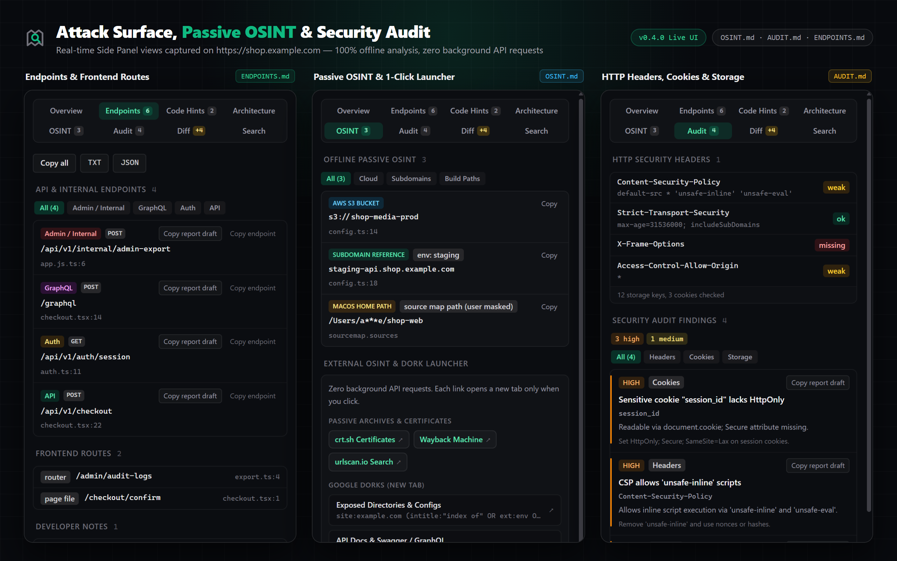
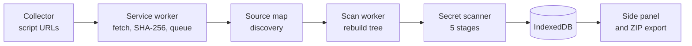

<div align="center">


# MapHound

**Rebuild exposed source maps and find the secrets they leak, entirely inside your browser.**

[](https://github.com/sezercixq/maphound/actions/workflows/ci.yml)
[](LICENSE)


</div>

Modern web apps ship minified bundles, and often the source maps that turn them back into the
original code: file names, comments, internal API routes and, too often, hard-coded credentials.
MapHound collects the scripts a page loads, recovers that source tree, scans it for secrets and lets
you export everything as a ZIP. No server, no account, no telemetry.

## Why MapHound?

|                                                                               | MapHound | Typical secret-finder extensions | Source map downloaders |
| ----------------------------------------------------------------------------- | :------: | :------------------------------: | :--------------------: |
| Rebuilds the original source tree from source maps                            |    ✅    |                ❌                |           ✅           |
| Finds lazy-loaded chunks and `SourceMap` headers, not just `<script>` tags    |    ✅    |              partly              |         partly         |
| Scans the original files **and** values inlined into the bundle at build time |    ✅    |           bundle only            |           ❌           |
| Reports the original file and line, mapped back through the source map        |    ✅    |                ❌                |           ❌           |
| Offline checksum and structure validation (GitHub CRC32, JWT, PEM)            |    ✅    |                ❌                |           ❌           |
| Every rule proven free of catastrophic backtracking (ReDoS) in CI             |    ✅    |                ❌                |          n/a           |
| Zip-Slip-safe export of attacker-controlled paths                             |    ✅    |               n/a                |         rarely         |
| No host access at install; one site at a time, revocable                      |    ✅    |       usually `<all_urls>`       |         varies         |
| Nothing leaves the browser                                                    |    ✅    |              varies              |           ✅           |

### Highlights

- **Source map reconstruction.** `SourceMap`/`X-SourceMap` headers, `sourceMappingURL` comments,
  inline `data:` maps, index maps with `sections`, XSSI prefixes. `node_modules` and `ignoreList`
  files are separated into `_vendor/`.
- **55 detectors** for AWS, Google Cloud, Azure, Cloudflare, Vercel, Heroku, Stripe, GitHub,
  GitLab, npm, OpenAI, Anthropic, Groq, Replicate, Hugging Face, OpenRouter, Perplexity, Slack,
  Supabase, Sentry, Mailgun, Twilio, SendGrid, private keys and more, written as YAML and compiled
  into the extension at build time.
- **Client-side attack surface & static code hints.** Extracts internal API endpoints (with HTTP
  methods), frontend/file-system routes, developer comments (`BYPASS`, `INTERNAL`, `TODO`),
  `__NEXT_DATA__` SSR prop summaries, and first-party static sinks (`dangerouslySetInnerHTML`,
  `innerHTML`, `eval`, unverified `message` listeners, open redirects) in separate tabs.
- **Client-side architecture & data-flow map.** Reconstructs module imports/exports, third-party
  SDK usage (Stripe, Firebase, Sentry, Auth0, Supabase, PostHog, etc.) and file → API calls into
  an interactive tree and a Mermaid diagram in `ARCHITECTURE.md`.
- **HTTP headers, HTML comments, cookie, Web Storage & stack audit.** Inspects CSP, HSTS,
  `X-Frame-Options`, CORS, all raw HTTP response headers (flagging `X-Debug-*`/`X-Internal-*`
  leaks), HTML DOM `<!-- ... -->` comments & `<meta>` tags, server/runtime banner leaks, session
  cookie framework fingerprints, `localStorage`/`sessionStorage` tokens (always masked) and cookie
  security flags (`HttpOnly`, `Secure`, `SameSite`) locally on enabled sites (`AUDIT.md`).
- **On-demand standard discovery files (`robots.txt` & `sitemap.xml`).** User-triggered button in
  the **OSINT** tab parses `Disallow:`, `Allow:`, `Sitemap:` and `<loc>` entries into clickable
  lists and includes them in `OSINT.md` and `ENDPOINTS.md` (zero background brute-force).
- **Snapshot & Diff tracking.** Compares deployments and rescans across files, endpoints, routes,
  secrets and code sinks (`DIFF.md`).
- **Source-to-Sink taint flow, AuthZ/IDOR & crypto/JWT auditing.** Tracks untrusted browser inputs
  (`location.*`, `URLSearchParams`, `event.data`, Web Storage) through local assignments into DOM
  XSS, code execution, open redirect and prototype pollution sinks (`L<src> → L<sink>`), flags
  unvalidated `postMessage` handlers, client-side AuthZ gates and IDOR endpoint candidates, and
  audits weak cryptography (`Math.random()`, `MD5`/`SHA-1`, ECB, static IV/salt) and JWTs
  (`alg: "none"`, >30-day lifetimes, privileged claims).
- **SARIF v2.1.0, OpenAPI 3.0.3 & 1-click disclosure drafts.** Exports `results.sarif` and Burp /
  Postman-ready `openapi.json` alongside Markdown/JSON reports and copies ready-to-send Markdown
  vulnerability drafts with masked evidence.
- **Offline Passive OSINT & 1-Click Launcher.** Extracts cloud storage buckets (S3, GCS,
  Firebase, Azure Blob, Cloudflare R2), subdomains, private RFC1918 IPs, masked build paths,
  attribution links and telemetry IDs purely offline (`OSINT.md`), plus 1-click external OSINT
  & Google Dork links that only open a tab on click with zero background requests.
- **In-panel code search & viewer.** Search rebuilt source files locally by text or regex inside the
  side panel and jump straight to the highlighted `file:line` without downloading the ZIP first.
- **A five-stage scanner** that stays fast on large bundles (about 100 ms for 5 MB): Aho-Corasick
  keyword prefilter, regex only around keyword hits, entropy and placeholder filtering, offline
  validators, context and suppression.
- **Low noise.** Placeholders such as `your_api_key_here` are dropped, checksums must match, and keys
  meant to be public (Stripe `pk_live_`, Firebase web config, Supabase anon keys) are reported as
  `info`, not as alarms.
- **CDNs and sibling domains, one click away.** Big apps serve their bundles from a CDN or another
  domain of theirs. MapHound groups those origins and scans them with **Allow & scan**, one origin
  or all of them at once, without ever asking for blanket access.
- **Private by construction.** Optional per-site host permissions only, no `webRequest`, no remote
  code, no outbound requests except to the site you enabled. See [`docs/PRIVACY.md`](docs/PRIVACY.md).

## Attack Surface, OSINT & Security Audit



## Quick start

### Install a build

1. Open the latest successful [CI run](https://github.com/sezercixq/maphound/actions/workflows/ci.yml)
   (sign in to GitHub), download the `maphound-<version>-chrome.zip` artifact and unzip it.
2. Go to `chrome://extensions`, turn on **Developer mode** and click **Load unpacked**.
3. Select the unzipped folder (the one that contains `manifest.json`).

### Build from source

Requires Node 22+ and pnpm (`corepack enable` picks the pinned version).

```bash
git clone https://github.com/sezercixq/maphound.git
cd maphound
pnpm install
pnpm build          # output: .output/chrome-mv3, load it as above
# or: pnpm dev      # Chrome with the extension and hot reload
```

### Use it

1. Open the site and click the MapHound toolbar icon to open the side panel.
2. Choose whether to include subdomains and whether to guess `<script>.map` URLs, then click
   **Enable this site**. Chrome asks for access to that site only.
3. MapHound lists scripts (including lazy chunks), the source maps it found and the **Findings**:
   severity, confidence, `file:line` in the original source, with reveal and copy.
   With subdomains on, the scope is the whole registrable domain (`*.airbnb.com.tr` for
   `www.airbnb.com.tr`).
4. Scripts from other origins are listed under **Third-party origins**. If one of them is really the
   site's own CDN or a sibling domain, click **Allow & scan** (or **Allow & scan all**; analytics and
   tag managers are left out unless you tick them). Chrome asks once, and those scripts are fetched
   and scanned like the site's own.
5. **Download sources (ZIP)** exports:

   ```
   FINDINGS.md                          readable secret report, secrets always masked
   findings.json                        machine-readable; raw values only if you opt in
   results.sarif                        SARIF v2.1.0 for GitHub Code Scanning / VS Code
   openapi.json                         OpenAPI 3.0.3 schema for Burp Suite / Postman
   ENDPOINTS.md                         extracted APIs, routes, dev notes, sinks & __NEXT_DATA__
   ARCHITECTURE.md                      Mermaid dependency diagram, SDK map & module inventory
   OSINT.md                             offline cloud buckets, subdomains, private IPs, masked paths & telemetry
   AUDIT.md                             HTTP security headers, cookie flags & Web Storage audit
   DIFF.md                              snapshot diff report (included when changes exist)
   manifest.json                        scanned URLs, hashes, what was skipped and why
   source/<host>/<script>/src/...       first-party files
   source/<host>/<script>/_vendor/...   node_modules and ignoreList files
   ```

6. **Disable and delete data** removes the collector, the site's data and every host permission it
   was granted, extra origins included.

## How it works



Scripts are fetched by the extension (no CORS issues, no cookies by default), stored once by hash,
and analysed in a worker. Maps are parsed and every path is sanitized before it can reach an
archive. Each script is scanned after its maps, so a secret found in the bundle can still be traced to
its original file. Details: [`docs/ARCHITECTURE.md`](docs/ARCHITECTURE.md).

## Contribute a detector

A detector is one YAML file. This is all it takes:

```yaml
id: acme-api-key
name: "Acme API key"
severity: high
confidence: high
keywords: ["acme_live_"]
regex: "(?<![A-Za-z0-9_])(acme_live_[A-Za-z0-9]{32})(?![A-Za-z0-9])"
secretGroup: 1
entropy: 3.5
references: [https://docs.acme.example/api-keys]
tests:
  positive: ['const key = "acme_live_{{}}Hq3ZtV9mK2pR7xW4bN8cL1fD6gJ0sY5a";']
  negative: ["acme_live_{{}}xxxxxxxxxxxxxxxxxxxxxxxxxxxxxxxx"]
```

Save it as `rules/saas/acme-api-key.yml` and run `pnpm rules:check`: it validates the schema, runs
your samples through the real scanner and proves the regex ReDoS-safe. The `{{}}` marker keeps fake
samples from tripping repository secret scanners. Validators for checksums and JWTs, public-key
handling and more are explained in [`CONTRIBUTING.md`](CONTRIBUTING.md).

Missing a provider? [Propose a detector](https://github.com/sezercixq/maphound/issues/new?template=new-detector.yml),
or open a pull request. Every rule ships with tests, so reviews are quick.

## Development

```bash
pnpm lint          # Biome lint and format check
pnpm typecheck     # TypeScript, strict
pnpm test          # 268 unit tests (Vitest)
pnpm rules:check   # rule schema, samples, ReDoS proof
pnpm preview:images # regenerate docs/assets/maphound*-preview.png from live UI
VITE_MH_E2E=1 pnpm build && pnpm test:e2e   # real-Chromium end-to-end tests (Playwright)
```

CI runs all of the above on every push and pull request and publishes the packaged extension as a
build artifact.

## Responsible use

MapHound is for **authorized security testing and for auditing your own applications.** Only enable
it on sites you own or have explicit permission to test, for example within the scope of a bug bounty
program. Source maps and bundles are publicly served, but what you do with what you find is your
responsibility.

If MapHound finds a credential on someone else's site, **do not use it**. Report it to the owner
through their security contact or bug bounty program so it can be revoked. The authors accept no
liability for misuse.

## Security and privacy

- Found a vulnerability in MapHound? Please report it privately: [`SECURITY.md`](SECURITY.md).
- What MapHound does and does not do with data, and why each permission is needed:
  [`docs/PRIVACY.md`](docs/PRIVACY.md).

## License

[MIT](LICENSE) © MapHound contributors
