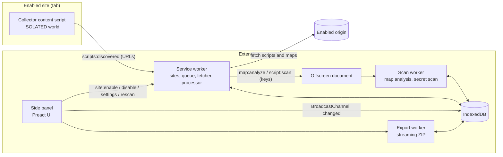
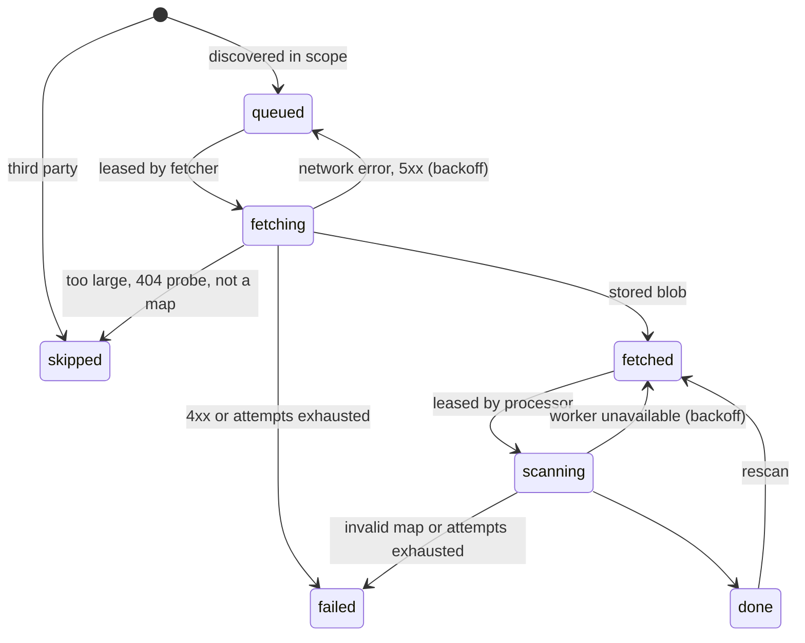

# Architecture

MapHound is a Chrome Manifest V3 extension built with [WXT](https://wxt.dev), TypeScript (strict),
Preact with signals and Tailwind CSS v4. Everything runs in the browser; there is no server.

## Components



| Context            | Code                                          | Role                                                                                                                                                                                                                                                 |
| ------------------ | --------------------------------------------- | ---------------------------------------------------------------------------------------------------------------------------------------------------------------------------------------------------------------------------------------------------- |
| Collector          | `src/entrypoints/collector.content.ts`        | Registered at runtime per enabled site. Collects script URLs from `document.scripts`, resource timing, a `PerformanceObserver` and added `<script>`/`modulepreload` nodes. Debounced 500 ms, at most 200 URLs per message. Never reads page content. |
| Service worker     | `src/entrypoints/background.ts`, `src/core/*` | Site lifecycle and permissions, job queue, fetcher (4 requests per origin, 10 s timeout, size caps, no cookies by default), processor. All listeners registered synchronously.                                                                       |
| Offscreen document | `src/entrypoints/offscreen/`                  | Exists only to host the scan worker: MV3 service workers cannot create workers.                                                                                                                                                                      |
| Scan worker        | `src/workers/scan.worker.ts`                  | Parses maps, rebuilds the source tree index, runs the secret scanner.                                                                                                                                                                                |
| Side panel         | `src/entrypoints/sidepanel/`, `src/ui/`       | Reads IndexedDB directly and re-queries when notified. Requests host permission inside the click gesture.                                                                                                                                            |
| Export worker      | `src/workers/export.worker.ts`                | Builds the ZIP with fflate and streams chunks to the panel, which saves it with `<a download>`.                                                                                                                                                      |

## Data model

IndexedDB is the single source of truth. Messages carry keys (hashes, job ids), never content, and
the `BroadcastChannel` only says "something changed".

| Store      | Key                         | Contents                                                          |
| ---------- | --------------------------- | ----------------------------------------------------------------- |
| `sites`    | origin                      | scope (`origin` or `subdomains`), settings (map probing, cookies) |
| `jobs`     | `script:<url>`, `map:<url>` | state machine below, attempts, lease, skip reason                 |
| `blobs`    | SHA-256                     | downloaded scripts and maps, content-addressed and stored once    |
| `scripts`  | SHA-256                     | URLs, size, source map reference, status                          |
| `maps`     | job id                      | rebuilt file index (paths, sizes, vendor, omissions), limits hit  |
| `findings` | `origin                     | rule                                                              | sha256(secret)` | severity, confidence, locations, masked preview, raw value |

Rebuilt file contents are not stored twice: the export rebuilds them from the map blob with the same
deterministic code that produced the index.

## Job lifecycle



Every in-flight job holds a lease (`leasedUntil`). If Chrome suspends the service worker, the next
wake-up (startup, install, a one-minute alarm) returns expired leases: downloads to `queued`, analyses
to `fetched`. Maps are processed before scripts, and a script is scanned only once all of its maps are
settled, so findings can point at original files.

## Source maps

`src/engine/sourcemap/`

1. **Discovery** (`src/core/sourcemap-discovery.ts`): `SourceMap` header, then `X-SourceMap`, then the
   trailing `sourceMappingURL` comment, then inline `data:` URIs. Guessing `<script>.map` is opt-in.
2. **Parse**: XSSI prefix, version 3 checks, hostile field types, index maps (`sections`) flattened.
3. **Rebuild**: files from `sources` and `sourcesContent`; `node_modules` and `ignoreList` go to
   `_vendor/`. Limits: 20,000 files, 200 MB, 10 MB per file; over a limit the result is `partial`.
4. **Sanitize**: every path is attacker controlled. Percent-decoding first, schemes, drive letters,
   UNC and device prefixes stripped, `..` clamped at the root, control, bidi and zero-width characters
   removed, Windows-reserved names prefixed, length and depth capped, collisions numbered
   case-insensitively. A fuzz test checks the invariants on thousands of hostile inputs.
5. **Positions**: `@jridgewell/trace-mapping` maps bundle positions to original files when a secret
   only exists in the bundle (values inlined at build time) or `sourcesContent` is missing.

## Secret scanning

`src/engine/scan/`, `src/engine/validators/`, `rules/`

| Stage                       | Implementation                                                                                                                                                     |
| --------------------------- | ------------------------------------------------------------------------------------------------------------------------------------------------------------------ |
| 1. Keyword prefilter        | Aho-Corasick automaton over all rule keywords, one pass, ASCII case-insensitive. Text without keywords never reaches a regex.                                      |
| 2. Windowed regex           | Each rule's regex runs only within its window (default ±300 chars) of its keyword hits; windows are merged. Files above 1 MB are scanned in overlapping chunks.    |
| 3. Entropy and placeholders | Shannon entropy threshold per rule; case-aware placeholder detection (`your_api_key_here`, `xxxxx`, `EXAMPLE`).                                                    |
| 4. Offline validators       | GitHub/npm CRC32 + Base62 checksum, JWT header/payload decoding, Supabase `service_role`, PEM structure. Passing gives `verified-format`; failing drops the match. |
| 5. Context                  | `maphound-ignore`, environment references, repeats merged, provider rules preferred over catch-all rules, public keys lowered to `info`.                           |

Rules are YAML, validated against `rules/_schema.json` and compiled at build time into
`src/generated/rules.json`. `pnpm rules:check` also proves each regex free of catastrophic
backtracking with recheck and times it on hostile input.

## Permissions

No static host permissions and no static content scripts. Host access is optional and requested per
site from the side panel; the service worker verifies it with `permissions.contains` before
registering the collector. Disabling a site unregisters the collector, revokes patterns no other
enabled site needs and can purge its data. Revocation from Chrome's own UI is detected and reconciled.
Details and justifications: [`PRIVACY.md`](PRIVACY.md).

## Testing

| Layer      | Tooling                   | Covers                                                                                                                                                             |
| ---------- | ------------------------- | ------------------------------------------------------------------------------------------------------------------------------------------------------------------ |
| Unit       | Vitest, fake-indexeddb    | scope, queue, fetcher (timeouts, limits, concurrency), discovery, sanitizer (fuzzed), parser, rebuild, scanner, validators, export, UI view model, locales         |
| Rules      | `pnpm rules:check`        | schema, every rule's positive and negative samples, ReDoS proof, timing                                                                                            |
| End to end | Playwright, real Chromium | permission flow, collector injection, lazy chunks, all discovery paths, map analysis, secret findings on deliberately leaked fake tokens, side panel, ZIP contents |

## Layout

```
rules/                 detector YAML and schema
scripts/               rule compiler and checker
src/core/              service-worker logic: db, sites, permissions, queue, fetcher, processor, scan job
src/engine/sourcemap/  parse, rebuild, sanitize
src/engine/scan/       keyword index, regex stage, entropy, suppression, scanner
src/engine/validators/ checksum and structural validators
src/engine/zip/        streaming export and findings reports
src/entrypoints/       background, collector, offscreen, side panel
src/ui/                side panel components, state, i18n
src/workers/           scan and export workers
tests/unit, tests/e2e  tests
```
